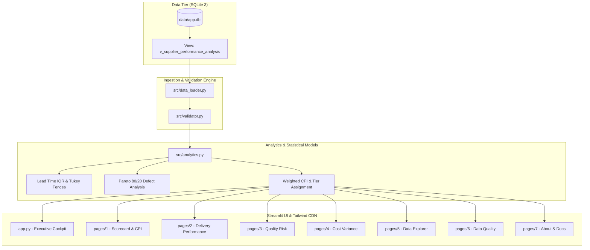

# Supplier Performance Analysis & Procurement Intelligence Platform

[](https://www.python.org/)
[](https://streamlit.io/)
[](https://www.sqlite.org/)
[](https://plotly.com/)
[](https://tailwindcss.com/)
[-brightgreen.svg)]()
[]()

> **ABES Engineering College • Department of Computer Applications**  
> **Master of Computer Applications (MCA) — Capstone Project (3rd Semester, Batch 2025–2027)**  
> **Learner:** Chitra Chauhan (University Roll No: `2500320140043`)  
> **Project Mentor:** Prof. Kalpana Dwivedi  

---

## 🏢 Executive Overview & Problem Statement

Modern manufacturing and enterprise supply chains suffer from fragmented procurement records, delayed delivery visibility, untracked component scrap rates, and unapproved invoice price creep.

This platform centralizes multi-tier procurement logs into an empirical, real-time analytics engine to solve:
1. **Chronic Delivery Latency & Short-Shipments:** Strict evaluation via On-Time In-Full (OTIF%).
2. **Component Defect Containment:** Parts Per Million (PPM) scrap rate tracking with Pareto 80/20 root cause prioritization.
3. **Unapproved Commercial Creep:** Line-by-line Purchase Price Variance (PPV%) auditing.
4. **Supplier Risk Segmentation:** Automated Composite Performance Index (CPI) scoring segmenting suppliers into Tier A (Preferred), Tier B (Conditional), and Tier C (Mandatory CAPA).
5. **Capital Protection:** Real-time Spend-at-Risk containment below the 10.0% enterprise tolerance ceiling.

---

## 🏛️ System Architecture



---

## 📐 Mathematical Formulation & KPI Logic

| Metric | Mathematical Formula | SLA Benchmark | Impact |
|:---|:---|:---:|:---|
| **On-Time In-Full (OTIF %)** | $$\text{OTIF} = \frac{\sum \text{is\_otif}}{\text{Total Deliveries}} \times 100$$ | $\ge 95.0\%$ | Eliminates partial shipment gaming; guarantees full order quantity on or before SLA date. |
| **Defect PPM** | $$\text{PPM} = \left(\frac{\text{Defective Qty}}{\text{Inspected Qty}}\right) \times 1,000,000$$ | $< 1,000\text{ PPM}$ | Normalizes component defect frequencies across varied lot sizes. |
| **Price Variance (PPV %)** | $$\text{PPV\%} = \left(\frac{\text{Invoiced} - \text{Contracted}}{\text{Contracted}}\right) \times 100$$ | $\le 0.0\%$ | Detects invoice markup creep and billing discrepancies. |
| **Composite Score (CPI)** | $$\text{CPI} = 0.40 \cdot \text{OTIF} + 0.35 \cdot \text{Qual} + 0.25 \cdot \text{Cost}$$ | Scale: $0\text{--}100$ | Multi-criteria vendor evaluation. Tier A ($\ge 85$), Tier B ($70\text{--}84.9$), Tier C ($< 70$). |
| **Spend-at-Risk %** | $$\text{Spend-at-Risk} = \frac{\sum \text{Spend}_{\text{Tier C}}}{\sum \text{Spend}_{\text{Total}}} \times 100$$ | $< 10.0\%$ | Restricts total procurement capital committed to non-performing suppliers. |

---

## 📁 Repository Directory Structure

```
supplier-performance-analysis/
├── app.py                           # UI-01: Executive Overview, Macro KPIs, Global Sidebar
├── pages/
│   ├── 1_📊_Supplier_Scorecard.py   # UI-02: Multi-metric CPI, Tier A/B/C, Weight Sliders, CAPA
│   ├── 2_🚚_Delivery_Performance.py # UI-03: OTIF Leaderboard, Lead Time Boxplot, Outlier Delays
│   ├── 3_🔬_Quality_Risk.py         # UI-04: Defect PPM, Pareto 80/20 Dual-Axis, Inspection Logs
│   ├── 4_💰_Cost_Variance.py        # UI-05: Price Variance (PPV), Cost Creep, Spend-at-Risk Gauge
│   ├── 5_🔍_Data_Explorer.py        # UI-06: 42-column interactive grid, multi-filters, CSV export
│   ├── 6_🛠️_Data_Quality.py        # UI-07: DB Health, FK Integrity, Null & Outlier Diagnostics
│   └── 7_ℹ️_About.py                # UI-08: Academic credits, architecture, and project documentation
├── src/
│   ├── __init__.py
│   ├── config.py                    # Constants, SLA baselines, color palettes, default weights
│   ├── database.py                  # Thread-safe SQLite connection manager & query helpers
│   ├── data_loader.py               # Cached extraction pipeline (@st.cache_data)
│   ├── validator.py                 # Data hygiene, schema validation & cleaning routines
│   ├── analytics.py                 # Mathematical & statistical computation engines
│   └── ui.py                        # Tailwind CSS components (headers, KPI cards, insight boxes)
├── data/
│   ├── app.db                       # Relational SQLite database (5 tables + 1 view)
│   ├── supplier_performance_data.xlsx# Master Excel workbook with sheet per table
│   └── *.csv                        # Individual entity CSV tables
├── tests/
│   ├── __init__.py
│   ├── test_data.py                 # Database connectivity, row counts, PK/FK checks
│   ├── test_analysis.py             # Math validation (OTIF, PPM, Price Var, CPI, Outliers)
│   └── test_app.py                  # Headless UI component smoke test & latency SLA
├── docs/                            # Project specifications & reports (Steps 1 to 15)
├── .streamlit/
│   └── config.toml                  # Streamlit theme (Navy #1A365D, wide layout)
├── requirements.txt                 # Pinned production dependencies
├── pytest.ini                       # Pytest execution configuration
├── BUILD_PLAN.md                    # Build implementation plan
└── README.md                        # Production setup, architecture & execution guide
```

---

## 🚀 Quickstart & Execution Guide

### 1. Environment Setup
```bash
# Clone repository
git clone https://github.com/2500320140043-chitra/supplier-performance-analysis.git
cd supplier-performance-analysis

# Create virtual environment
python -m venv .venv

# Activate virtual environment
# Windows PowerShell:
.venv\Scripts\Activate.ps1
# Linux / macOS:
source .venv/bin/activate

# Install dependencies
pip install -r requirements.txt
```

### 2. Generate / Reset Relational Database
```bash
python src/generate_data.py
```

### 3. Run Automated Pytest Suite
```bash
python -m pytest -v
```
*Expected Result:* **16 passed in ~4.0s (100% pass rate)**.

### 4. Launch Streamlit Application
```bash
streamlit run app.py
```
Open your browser at `http://localhost:8501`.

---

## 🧪 Quality Assurance & Test Verification Matrix

| Test ID | Scope | Verification Target | Status |
|:---:|:---|:---|:---:|
| `TC-T-01` | Database | SQLite connection active with Foreign Keys pragma enabled | **PASS** |
| `TC-T-02` | Schema | Minimum row counts: 25 suppliers, 6 categories, 40 SKUs, 300 POs | **PASS** |
| `TC-T-03` | Schema | Primary Key uniqueness verified across all relational tables | **PASS** |
| `TC-T-04` | Integrity | `PRAGMA foreign_key_check` returns 0 relational orphan violations | **PASS** |
| `TC-T-05` | Schema | Unified analytical view `v_supplier_performance_analysis` $\ge$ 40 cols | **PASS** |
| `TC-T-06` | Formula | OTIF mathematical computation on deterministic test vector | **PASS** |
| `TC-T-07` | Statistics | Parametric lead time mean, standard deviation, and median | **PASS** |
| `TC-T-08` | Formula | Defect PPM zero-division protection and arithmetic correctness | **PASS** |
| `TC-T-09` | Formula | Purchase Price Variance (PPV %) percentage calculation | **PASS** |
| `TC-T-10` | Model | Weighted Composite Performance Index (CPI) scoring equation | **PASS** |
| `TC-T-11` | Risk | Spend-at-Risk percentage ratio against portfolio spend | **PASS** |
| `TC-T-12` | Statistics | Tukey's fences IQR extreme delivery delay outlier isolation | **PASS** |
| `TC-T-13` | UI | Tailwind CSS iframe helper components render valid HTML | **PASS** |
| `TC-T-14` | SLA | Unified view query latency executes in $< 2.5$ seconds (Observed: 0.05s) | **PASS** |
| `TC-T-15` | Module | `compute_kpi_summary` generates all macro metrics correctly | **PASS** |
| `TC-T-16` | Module | `compute_defect_pareto` computes descending cumulative shares | **PASS** |

---

## 🎓 Academic Attribution & License

* **Student:** Chitra Chauhan (Roll No: 2500320140043)
* **Mentor:** Prof. Kalpana Dwivedi
* **Institution:** Department of Computer Applications, ABES Engineering College, Ghaziabad
* **License:** Educational Academic Project under MIT License.
